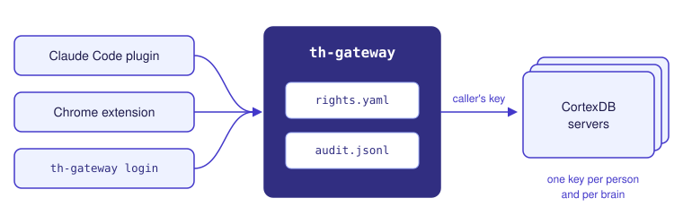
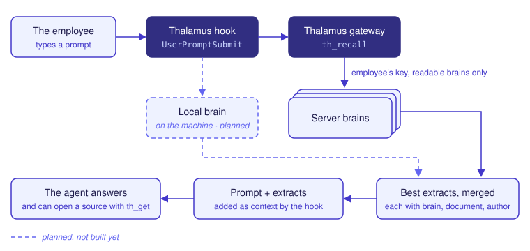

<p align="center"></p>

# Thalamus

[English](https://github.com/lfoletti/thalamus/blob/main/README.md) | 简体中文 | [日本語](https://github.com/lfoletti/thalamus/blob/main/README.ja.md) | [한국어](https://github.com/lfoletti/thalamus/blob/main/README.ko.md) | [Deutsch](https://github.com/lfoletti/thalamus/blob/main/README.de.md)

[](https://github.com/lfoletti/thalamus/actions/workflows/ci.yml) [](https://github.com/lfoletti/thalamus/releases) [](LICENSE)

Thalamus 在每个人的权限范围内，把组织的知识带给每位用户及其编程 agent。它构建在 [CortexDB](https://github.com/liliang-cn/cortexdb) 之上。

> **开发中。** 各版本之间的接口会有变化。

## 功能

一个团队把知识保存在多个 CortexDB 大脑中：一个属于团队，一个属于某个客户，一个属于整个组织。每位用户可以读取其中一部分，可写入的更少。Thalamus 是用户与这些大脑之间的网关。

用户的助手通过网关访问大脑，网关是一个 MCP 服务器。助手用 `th_recall` 提问时，网关以该用户自己的 key 检索该用户可读的每个大脑，并合并结果。每条摘录都附有来源：大脑、文档和作者。助手可用 `th_get` 读取摘录背后的完整文档。

用户也可以从 Claude Code 或 Chrome 中的页面提交文档。文档等待该大脑的一位审核人接受或拒绝。

## 为什么使用

### 1. 治理

Thalamus 是一个轻量的治理层。它让组织平稳、高效地共享知识，并让每次访问都处于控制之下。管理保持简单：权限在一个文件中，key 随权限而定，更改无需重启即可生效。

- **无需申请即可访问。** 用户以组织账号登录（OpenID Connect）。网关签发权限所允许的 key。要让某人访问一个团队的大脑，只需在 `rights.yaml` 中把该登录名加入团队的组。更改在下一次调用时生效，无需重启。
- **每人每个大脑一把 key。** CortexDB 在每次调用时检查 key，因此 key 的范围不依赖于网关。要撤销某一个人，网关只删除此人的 key。
- **一步加入知识。** 用户从 Claude Code 或 Chrome 中的页面提交文档。该大脑的一位审核人在同样的工具中接受或拒绝它。
- **管理简单。** `th-gateway key list` 将 key 与权限对比，`key sync` 修正差异。`th-gateway audit` 汇总读取、写入、拒绝和登录情况。

### 2. 合规与主权

Thalamus 的设计旨在支持遵守欧盟《通用数据保护条例》（GDPR）、瑞士《联邦数据保护法》（FADP），以及在高风险用途下的欧盟《人工智能法》。工具本身不能让组织合规。但 Thalamus 提供了这些框架所要求的控制措施：

| 控制措施 | Thalamus 中的实现 | 条款 |
| :- | :- | :- |
| 数据最小化 | 读取按大脑、按天计数，不记录姓名。只有设置了 `audit_reads: true` 的大脑才记录具名读取。 | GDPR 第 5(1)(c)、25(2) 条。FADP 第 6(2)、7(3) 条。 |
| 存储限制 | `audit: retention_days` 限制审计记录的保留时长。 | GDPR 第 5(1)(e) 条。FADP 第 6(4) 条。 |
| 安全与可追溯性 | 个人 key，由引擎检查。写入、审核、登录和被拒绝的调用各有一行记录，含当事人姓名。 | GDPR 第 5(1)(f)、5(2)、32 条。FADP 第 8 条。 |
| 数据位置 | 组织自行托管网关和 CortexDB 服务器。本地大脑留在用户的机器上，不经过网关。 | GDPR 第 44 条。FADP 第 16 条。 |
| 透明度 | 每条摘录都给出其大脑、文档和作者。 | GDPR 第 5(1)(a) 条。 |
| **未涵盖**：向模型提供方的传输 | 钩子把段落放进提示词，而提示词会发送给助手的模型提供方。Thalamus 不控制这一传输。组织需自行处理：与提供方签订数据处理协议，在提供方位于瑞士或欧盟以外时采取传输保障措施，并在提供方处设置保留期限。 | GDPR 第 28 条、第 44 至 46 条。FADP 第 9、16 条。 |

设置了 `audit_reads: true` 的大脑会保留具名读取日志，该日志属于个人数据：组织需告知用户、答复其访问请求并设定保留期限（GDPR 第 13、15 条。FADP 第 19、25 条）。

**如果属于高风险用途。** 下列《人工智能法》条款仅适用于高风险人工智能系统。面向编程 agent 的召回一般不属于高风险用途。对于高风险系统的部署者，Thalamus 提供相应的控制措施：

| 控制措施 | Thalamus 中的实现 | 条款 |
| :- | :- | :- |
| 记录保存 | 写入、审核、登录和被拒绝的调用各有一行记录，含当事人姓名。 | 《人工智能法》第 12 条。 |
| 人工监督 | 提交的文档须经审核人处理后，召回才会提供它。 | 《人工智能法》第 14 条、第 26(2) 条。 |

GDPR：欧盟《通用数据保护条例》（Regulation (EU) 2016/679）。FADP：修订后的瑞士《联邦数据保护法》（revDSG，SR 235.1）。《人工智能法》：欧盟《人工智能法》（Regulation (EU) 2024/1689）。

### 3. 一次召回涵盖本地与共享大脑

- **大小合适的大脑。** 一个大脑可以是整个 CortexDB 服务器，也可以是共享服务器中的一个集合。小团队可以共用一台服务器。敏感的大脑可以有自己的服务器。
- **联邦。** 一个问题会到达用户可读的每个大脑。网关合并结果，每个大脑有各自的权重。用户无需选择在哪里查找。
- **本地与共享并用。** 在 Claude Code 中，钩子在每次提示时同时询问共享大脑和本机的本地大脑。每个人用 `/th-recall` 选择自动召回所用的大脑（参见[组合本地与全局大脑](#combining-local-and-global-brains)）。

### 4. 可核查的准确性

- **附带来源的段落。** 召回提供文档中的段落，而不是简短摘录。agent 可用 `th_get` 读取完整文档。
- **综述金字塔。** 一个大脑可以在其文档之上有一个综述集合。`th_recall` 先提供综述，`th_descend` 打开某篇综述所引用的文档。
- **经过测量。** 在一个研究试点中，自动召回找到的事实比例从 51.7 % 提高到 81.3 %（使用段落和综述），加上问题的英文变体后达到 85.1 %。
- **跨大脑的实体。** `th_entity` 在用户可读的每个大脑中查找同一个实体。它按节点 id 合并邻居，并指出提供每个邻居的大脑。
- **下一步。** 使用 CortexDB v2.139.0 的工具，对照来源核查综述中的每个句子。

### 5. 多语言

用户用自己的语言提问，而回答问题的文档常常是另一种语言。`th_recall` 接受其他语言的问题（`alternate_queries`），并分别检索每一种。

- 瑞士基准（`tests/eval_ch/`）包含 40 个关于联邦宪法的问题，使用德语、法语、意大利语和罗曼什语。每个问题都要求找到另一种语言的条文。
- 使用 `multilingual-e5-large` 和变体时，97 % 的预期条文出现在前 10 个结果中，罗曼什语为 91 %。不使用编码器时，只有 7 %。

对于编程 agent，Thalamus 把知识带入会话：对每个助手通过 MCP，在 Claude Code 中则通过每次提示时的自动召回。

## 概念

| 术语 | 含义 |
| :- | :- |
| 大脑 | 一台 CortexDB 服务器，或共享服务器中的一个集合。 |
| 权限 | 文件 `rights.yaml`。它声明大脑、组，以及谁可以读取、写入或审核每个大脑。 |
| key | 某个人在某个大脑上的 CortexDB API key。网关把它写入服务器的 key 文件，限定在该大脑的集合内，只读或读写。 |
| 审核人 | 接受或拒绝提交到某个大脑的文档的人。 |

## 工作原理

<p align="center"></p>

- 网关读取 `rights.yaml` 并签发 key。文件变化时它会重新读取，因此被移除的权限在下一次调用时生效。
- 每次调用都以调用者的 key 发往 CortexDB。CortexDB 在每次调用时检查 key，因此 key 的范围不依赖于网关。
- 网关在 `audit.jsonl` 中保留审计记录，用于安全和可追溯性。写入、审核、登录和被拒绝的调用各有一行记录，含当事人姓名。读取按大脑、按天计数，不记录姓名。只有在 `rights.yaml` 中设置了 `audit_reads: true` 的大脑才记录具名读取。`audit: retention_days` 限制记录的保留时长。
- 用户通过组织的身份提供方登录（OpenID Connect）。随后网关签发权限所允许的 key。

## <a id="combining-local-and-global-brains"></a>组合本地与全局大脑

Claude Code 的 Thalamus 插件在网关的工具之外增加了一个钩子。每次提示时，钩子同时询问共享大脑和本机的本地大脑。它在 agent 回答之前把最佳摘录交给 agent。用户无需主动请求。

<p align="center"></p>

- 钩子（`th-hook`，挂在 `UserPromptSubmit` 事件上）以用户的 key 把提示词发送给 `th_recall`。它把文档中的最佳段落连同来源加入提示词，不超过 9,000 个字符：10 个段落；当某个大脑有综述金字塔时，前面还有 4 个综述段落。
- 少于 3 个词的提示词或 `/` 命令不会触发查询。
- 它从不阻止提示词。如果网关没有响应，或 key 被拒绝，提示词会在没有摘录的情况下继续。
- agent 可用 `th_get` 打开某条摘录的完整文档。

- 对于本地大脑，钩子运行 CortexDB 的原生召回，每个大脑一次。默认情况下，唯一的本地大脑是项目的大脑。一项设置可以加入其他本地大脑，例如主目录中的大脑或另一个项目的大脑。
- 本地大脑留在机器上。它们不经过网关，也不在审计记录中。
- 该区块先列出共享摘录，然后每个本地大脑各占一节。本地部分不超过 3,000 个字符。
- 每个人用 `/th-recall`（`on`、`off`、`only`）选择自动召回所用的本地和共享大脑。这一选择不改变权限。

其他助手通过 MCP 使用相同的工具。自动召回需要助手中有钩子。Thalamus 为 Claude Code 提供了一个。

## 安装

每个版本包含以下文件：

- `thalamus_<version>_<os>_<arch>.tar.gz`：二进制文件 `th-gateway` 和 `th-hook`，适用于 macOS 和 Linux，amd64 和 arm64。
- `thalamus-plugin_<version>_<os>_<arch>.tar.gz`：Claude Code 插件，`bin/` 中带有 `th-hook`。用 `claude --plugin-dir thalamus-plugin` 启动 Claude Code。
- `thalamus-extension_<version>.zip`：Chrome 扩展。解压后打开 `chrome://extensions`，开启开发者模式，然后点击 **Load unpacked**（加载已解压的扩展程序）。
- `checksums.txt`：每个文件的 SHA-256。

`th-gateway version` 和 `th-hook version` 打印二进制文件的发行版本，网关上的 `GET /v1/version` 无需 key 即可应答：部署据此与预期的发行版本核对。

如果有 Go，可从源码安装二进制文件：

```sh
go install github.com/lfoletti/thalamus/gateway/cmd/th-gateway@latest
go install github.com/lfoletti/thalamus/gateway/cmd/th-hook@latest
```

网关也提供镜像。把 `rights.yaml` 和 key 文件放在一个目录中，然后挂载到 `/etc/thalamus`：

```sh
docker run -p 8787:8787 -v /srv/thalamus:/etc/thalamus ghcr.io/lfoletti/thalamus:latest
```

审计文件位于 `/var/lib/thalamus`。在该处挂载一个卷以保留它。网关需要为每个大脑提供一台 CortexDB gRPC 服务器（参见[试用](#try-it)）。

## <a id="try-it"></a>试用

以下步骤先启动一台带两个大脑的 CortexDB 服务器，再启动网关，最后启动插件。所有步骤都在本仓库的根目录中执行。

1. 把 CortexDB 克隆到 `cortexdb/`（与 `gateway/` 并列），然后构建二进制文件。

   ```sh
   git clone https://github.com/liliang-cn/cortexdb.git && (cd cortexdb && git checkout v2.139.0)
   mkdir -p bin
   (cd cortexdb && go build -o ../bin/cortexdb-grpc ./cmd/cortexdb-grpc)
   (cd gateway && go build -o ../bin/th-gateway ./cmd/th-gateway && go build -o ../plugin/bin/th-hook ./cmd/th-hook)
   ```

2. 写好权限文件和一个空的 key 文件。

   ```yaml
   # rights.yaml
   brains:
     team/acme:
       addr: 127.0.0.1:47998
       keys_file: keys.json
       collection: team-acme
       readers: [group:acme]
       writers: [user:alice]
       curators: [user:carol]
     org/handbook:
       addr: 127.0.0.1:47998
       keys_file: keys.json
       collection: handbook
       readers: [group:acme]
       writers: [user:carol]
   groups:
     acme: [alice, bob, carol]
   ```

   ```sh
   echo '{"keys":[]}' > keys.json
   ```

   key 文件位于 `keys_file` 给出的路径。相对路径从运行 `th-gateway` 的目录算起。网关把 key 写入该文件，服务器通过 `-keys` 读取它。

3. 签发 key，然后启动服务器。服务器在启动时读取其 key 文件。

   ```sh
   bin/th-gateway key sync rights.yaml
   bin/cortexdb-grpc -db brain.db -addr 127.0.0.1:47998 -keys keys.json &
   ```

4. 启动网关。

   ```sh
   bin/th-gateway serve rights.yaml --listen 127.0.0.1:8787 &
   ```

5. 带插件启动 Claude Code。使用 `key sync` 打印出的某个 key。

   ```sh
   export TH_GATEWAY=http://127.0.0.1:8787 TH_KEY=<secret>
   claude --plugin-dir ./plugin
   ```

如果 `rights.yaml` 中有 `identity` 区块，`th-gateway login http://127.0.0.1:8787` 可取代第 5 步中的 export。详情见 `gateway/README.md`、`plugin/README.md` 和 `extension/README.md`。

## 路线图

**已完成**（2026 年 10 月 25 日，版本 0.4.0）

- 权限、key，以及每个大脑一个 MCP 端点。
- 在某人可读的大脑上进行联邦召回，每条摘录附有来源。
- 提交文档及审核人对其的审核。
- 为不使用 MCP 的客户端提供 REST 端点。
- 通过 OpenID Connect 登录，可从命令行和扩展中进行。
- Claude Code 插件：召回钩子、工具和 `/th-add` 命令。
- Chrome 扩展：提交一个页面或一段选中内容。它保留页面的主要内容。
- 适度的审计：具名记录写入、审核、登录和拒绝，读取不具名计数，仅在要求的大脑上记录具名读取，并设有保留期限。
- 一次召回涵盖本地与共享大脑：钩子加入本机的本地大脑，每个人选择自动召回所用的大脑。
- 召回基于文档中的段落，而不是简短摘录。
- 每个大脑一个综述金字塔：`th_recall` 先提供综述，`th_descend` 打开某篇综述所引用的文档。
- 跨大脑的实体：`th_entity` 以用户在各大脑上的 key 向每个大脑查询一个实体及其邻居，并按 id 合并节点。
- 在 `th_recall` 或 `th_entity` 期间，大脑每拒绝一把 key，就记录一行审计。
- 多语言问题：`th_recall` 接受其他语言的问题（`alternate_queries`），并分别检索每一种。`tests/eval_ch/` 中的瑞士基准测量从一种语言到另一种语言（法语、德语、意大利语、罗曼什语）的召回。
- 召回的截止时间：`th_recall` 接受 `deadline_ms`，并融合已就绪的大脑的回答。钩子使用它，因此一个慢的大脑不再阻碍其他大脑的召回。
- Claude Code 中的大脑：`/brains` 打开大脑列表对话框，显示每个大脑是否响应，按 Enter 可为自动召回开启或关闭某个大脑。不带参数的 `/th-recall` 以勾选清单询问。项目的 `CLAUDE.md` 指定 `th_add` 写入的大脑。
- 发布：适用于 macOS 和 Linux 的 `th-gateway`、`th-hook`、插件和扩展的归档文件，Docker 镜像 `ghcr.io/lfoletti/thalamus`，以及 `go install`。参见[发布页面](https://github.com/lfoletti/thalamus/releases)。

**与 CortexDB 协作**

凡是对每位 CortexDB 用户都有用的机制，Thalamus 都依赖 CortexDB 提供。这些部分以小型 pull request 的形式提交给 CortexDB。

- 已合并：受限 key 的工具允许列表（#72 至 #74、#78），内容哈希与重复检查（#75），过期日期（#76），审核状态（#77），以及其他修复（#61、#67 至 #71、#82、#83）。
- 已在 v2.139.0 中合并，源自讨论 #86：
  - key 与签名：服务器在 key 文件变化时重新读取，因此新增或撤销的 key 无需重启即可生效（#87）。每次写入都由调用者的 key 签名（#88）。只有在调用者的范围允许时才会读取记忆（#89）。
  - 适用于限定在单个集合内的 key 的图工具（#94 至 #98）。`th_entity` 用它们在段落之外跨大脑合并实体。
  - 三个工具和一个索引：请求日志中记录被触及的 id（#90），对 id 列表执行 `knowledge_get`（#91），对照所引用来源核查一个句子（#92），并删除了两个冗余的边索引（#93）。
  - 欧洲语言检索：一个瑞士评测集（#99），覆盖率下限中的重音处理（#100），以及备选查询的词和运行（#101、#102）。
- 已提议：`upsert_entities` 记录它所指名的分块所属的集合（#105），使 `th_entity` 能提供在 Thalamus 之外构建的大脑中的实体。
- Thalamus 使用 CortexDB v2.139.0。
- 已准备：一个列出待审核文档的工具。

**下一步**

- 为通过 `th_add` 填充的大脑提供实体：网关目前还没有抽取器。
- 为 `th-hook` 提供简单的安装渠道，并把扩展上架 Chrome Web Store。
- 在 README 中加入简短演示。

## 原则

1. **引擎检查每一把 key。** 网关决定谁获得 key。CortexDB 决定每把 key 可以做什么。
2. **每人每个大脑一把 key。** 网关可以撤销某一个人在某一个大脑上的访问权。
3. **每条摘录都显示其来源。** 读者可用 `th_get` 打开摘录背后的文档。
4. **通用机制提交到上游。** Thalamus 只保留组织的策略：权限、组、审核人以及服务器之间的联邦。

## 开发

修改前请阅读 [CONTRIBUTING.md](CONTRIBUTING.md)，报告缺陷请阅读 [SECURITY.md](SECURITY.md)，另请阅读 [CODE_OF_CONDUCT.md](CODE_OF_CONDUCT.md)。

```sh
cd gateway && go test -race ./...           # coverage 100 % outside the two main functions
python3 -I mutate.py                         # one hand mutation per rule, each must fail a test
cd ../extension && npm install && node --test
cd .. && sh tests/e2e_gateway.sh             # a real CortexDB server and the gateway
sh tests/e2e_extension.sh                    # the extension in Chromium
```

每个测试都在其代码之前编写，并且在没有该代码时会失败。完整流程见 `docs/pipeline_pr.md`。项目的大多数文档使用法语。

## 许可证

MIT。CortexDB 同样采用 MIT 许可证。

---

本文件译自 [README.md](https://github.com/lfoletti/thalamus/blob/main/README.md)。两者不一致时，以英文版为准。请用英文提交 issue。
